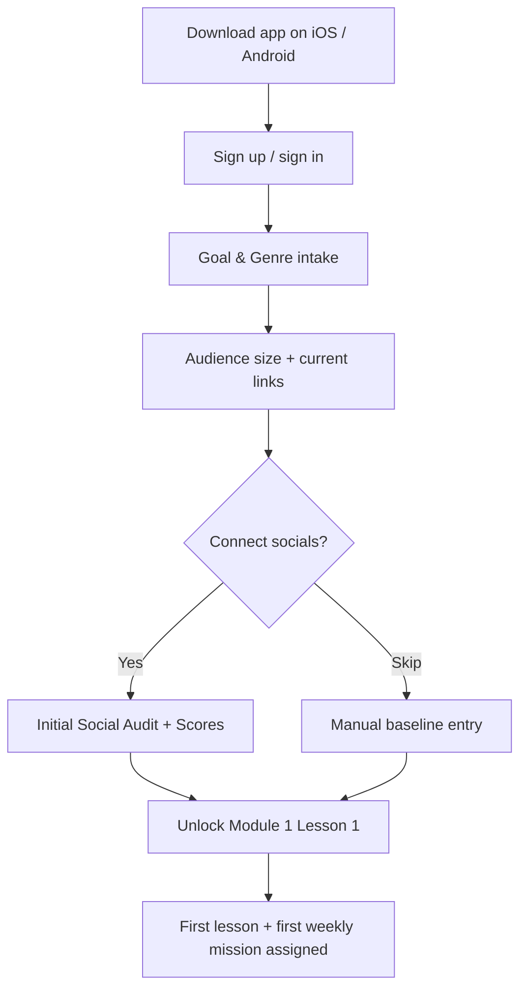
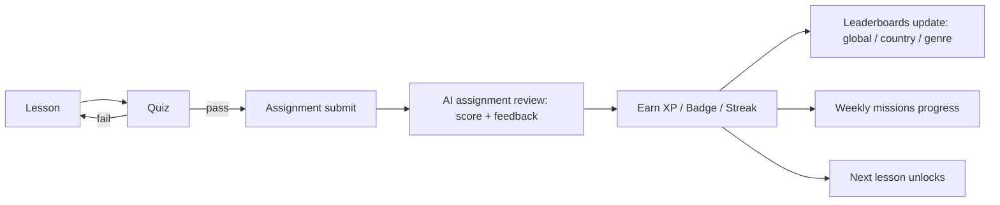
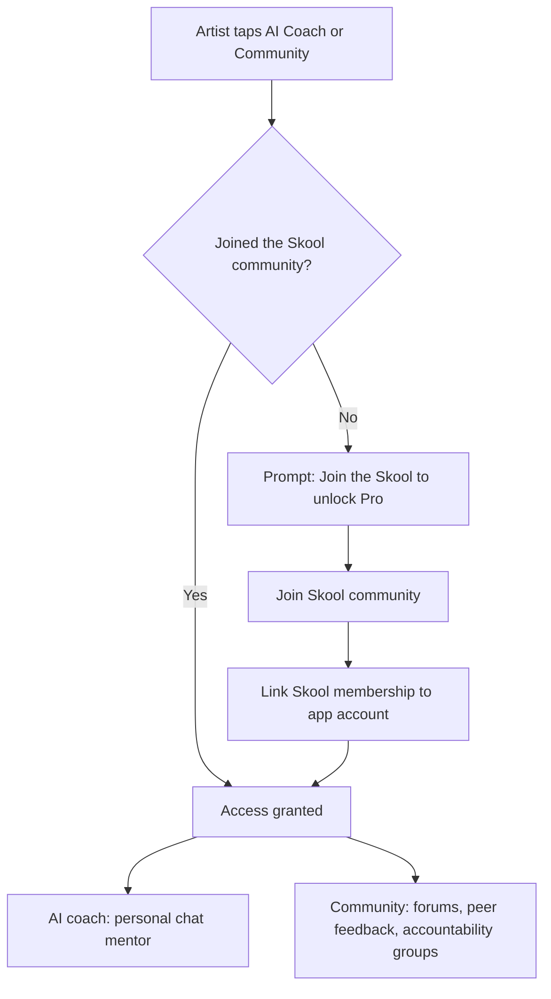

# Riff — AI-Powered Music Artist Education Platform

> Positioning: Duolingo's engagement × Coursera's structure × ChatGPT's intelligence, applied to the *business and marketing* of an independent music career.

---

## Current Features

These are the full features of the app as of now.

- **Structured courses** — Lessons, quizzes, and assignments that unlock step by step as artists progress.
- **Gamification** — XP, badges, levels, and daily streaks to keep artists engaged and finishing courses (Duolingo-style).
- **AI assignment review** — Artists submit work (text, links, images, audio, video, PDFs) and instantly get a score plus strengths, weaknesses, and next steps.
- **Social media audit** — Connects an artist's socials and scores their marketing, branding, growth, and consistency, tracked month over month.
- **Weekly missions** — Real-world challenges that reward XP and badges.
- **Leaderboards** — Global, country, and genre rankings, with rewards for top performers.

## User Flow

### 1. Download → First Value (Free)

### 2. Free Learning Loop

All of the above runs entirely inside the **free** app — courses, gamification, AI assignment review, social audit, weekly missions, and leaderboards.

### 3. Unlocking Pro (Join the Skool)

**Pro gate rule:** the AI coach and Community are the two Pro features. Tapping either while on Free surfaces a single, honest prompt to join the Skool community; joining links the membership to the app account and unlocks both. Everything else stays free.
